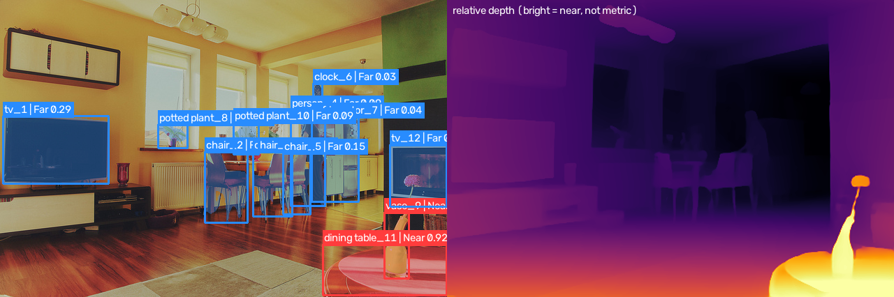

# RoboSight



Software-only robotic visual perception. A single monocular RGB stream becomes a structured 2.5D scene graph (JSON plus annotated overlay) that a robot-style query layer can answer questions over. No physical hardware is needed.

```
RGB frame
  |-- YOLOv8-Seg ----> boxes + instance masks
  |-- Depth Anything V2 Small --> relative depth map
  '-- ByteTrack --------> persistent track IDs --> motion estimate
        |
   Depth alignment (median depth per mask) --> Near / Mid-Range / Far
        |
   Spatial predicates: left_of, right_of, closer_than, behind, overlay
        |
   Scene graph (JSON + overlay) --> rules-based Query Engine
```

## Setup (Windows / Linux / macOS, Python 3.10+)

```
python -m venv .venv
.venv\Scripts\activate          # Linux/macOS: source .venv/bin/activate
pip install -r requirements.txt
```

For GPU use, install the CUDA build of PyTorch from pytorch.org first. Otherwise it runs on CPU. First run downloads `yolov8n-seg.pt` (Ultralytics) and the Depth Anything V2 Small weights (Hugging Face); both are cached afterwards.

## Usage

```
python scripts/run_pipeline.py --input data/images/street.jpg --query "Which object is closest to the camera?" --query "What is to the left of the car?"
python scripts/run_pipeline.py --input data/videos/clip.mp4 --max-frames 200 --query "what is moving"
python scripts/run_pipeline.py --input webcam --show
```

Outputs go to `results/`: `<name>_annotated.(png|mp4)`, `<name>_scene_graph.json` (image) or `<name>_scene_graphs.jsonl` (video, one graph per line). Per-stage latency is measured and printed at the end of every run.

Useful flags: `--device cpu|cuda`, `--weights`, `--depth-model`, `--conf`, `--stride N`, `--no-video`, `--config path.yaml`. Everything else is in `config/default_config.yaml`.

Queries understood by the engine: closest/farthest (optionally per class), left/right of X, closer/farther than X, behind X, in front of X, overlapping X, nearest to X (image plane), how many X, moving / stationary / approaching / receding, near / mid-range / far, describe. X is a class (`car`) or an object ID (`person_3`).

## Evaluation

```
python scripts/evaluate_depth_spatial.py --images-dir data/nyu_mini/images --gt-dir data/nyu_mini/depth
```

With ground-truth depth it reports pixel-level Spearman correlation, affine-invariant AbsRel, and pairwise object-ordering accuracy. Without `--gt-dir` it reports only object/relation counts and latency. No numbers are included in this repository; run it on your own data and report what you get.

## Methodology

- **Detection/segmentation:** YOLOv8-Seg; polygons are rasterized to full-resolution boolean masks.
- **Depth:** Depth Anything V2 Small outputs affine-invariant relative inverse depth. It is normalized per frame with 1st/99th percentiles into `relative_nearness` in [0, 1] (1 = nearest).
- **Alignment:** the median `relative_nearness` inside each (slightly eroded) mask is the object's depth; if the mask is missing or tiny, the central box region is used (`depth_source` records which). Buckets: Near >= 0.66, Mid-Range >= 0.33, Far below (configurable).
- **Tracking:** Ultralytics' ByteTrack implementation is fed the detector's outputs. Motion is a least-squares slope over a sliding window of centroids (image-plane px/s) and of nearness (approaching/receding).
- **Predicates** (all thresholds in config):
  - `left_of` / `right_of`: centroid x separation > 0.25 x mean box width.
  - `closer_than`: nearness difference > 0.10.
  - `behind`: masks overlap (>= 30% of the smaller mask) and the subject is farther by > 0.10.
  - `overlay`: masks overlap with no clear depth order (symmetric, emitted once per pair).

## Scene graph format

```json
{
  "frame_index": 0, "timestamp_s": 0.0, "width": 640, "height": 480,
  "depth_semantics": "relative inverse depth ... Not metric ...",
  "objects": [{"uid": "person_1", "label": "person", "track_id": 1, "bbox": [..],
               "relative_nearness": 0.87, "depth_bucket": "Near", "depth_source": "mask",
               "motion": null}],
  "relations": [{"subject": "person_1", "predicate": "closer_than", "object": "car_2"}]
}
```

Objects without a track yet are named `<label>_u<idx>`. In single-image mode tracking is off and IDs are per-image indices.

## Limitations

- Depth is **relative, not metric**. Nearness is normalized per frame, so values are not comparable across frames or images, and Near/Far are scene-relative labels, not distances.
- Per-frame normalization can make depth flicker in video; `depth.interval` reuses depth across frames for speed but adds lag.
- Motion is in image pixels and is affected by camera motion; there is no ego-motion compensation or 3D velocity.
- Left/right is image-plane, not robot-frame. Occlusion (`behind`) relies on mask overlap plus noisy depth.
- Detection is limited to the 80 COCO classes; failures upstream propagate to the graph.
- The query engine is regex/rule based, not a language model.
- Unit tests cover the spatial, motion, and query logic with synthetic data; model wrappers need a first-run download and are checked by running the pipeline.

## Tests

```
pytest -q
```

## Layout

```
config/default_config.yaml
src/{config.py, pipeline.py}
src/perception/{detector, depth_estimator, tracker}.py
src/spatial/{depth_aligner, scene_graph}.py
src/reasoning/query_engine.py
src/utils/{logger, visualizer}.py
scripts/{run_pipeline, evaluate_depth_spatial}.py
tests/{test_perception, test_spatial}.py
```
